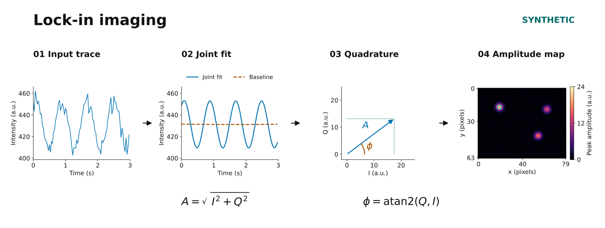

# Lock-in imaging

**Recover periodic fluorescence from image stacks with an inspectable, exposure-aware numerical pipeline.**

[](https://github.com/chineseschrodingercat/lockin-imaging/actions/workflows/ci.yml)




**Figure 1. A consistent synthetic workflow.** The input trace, joint fit and
I/Q vector correspond to the fixed pixel marked by the cyan ring in the amplitude
map. All 512 frames are fitted; the trace panels display the first 3 s. The vector
length is exposure-corrected sinusoidal peak amplitude, and its angle follows
`A cos[2πf(t−t₀)−φ]`. [Full figure legend and settings](docs/figure-legends.md#figure-1-from-a-recorded-trace-to-a-pixelwise-amplitude-map).

Fluorescence brightness alone does not reveal whether a location responds to a
periodic stimulus. This package estimates the component at a supplied reference
frequency for every pixel, while accounting for slow drift and finite camera
exposure. It provides a small Python API, a command-line workflow, deterministic
synthetic examples, and tests of the numerical and data-handling contracts.

This is a **public engineering companion to ongoing fluorescence/quantum-sensing
research led by Minhao Liu**. It is a deliberately reduced, refactored software
example, not the complete experimental analysis or a reproduction of unpublished
findings. Every data figure and result in this repository is synthetic.

## Run the demo

Python 3.11–3.13. Run these commands from a clone of this repository:

```bash
python -m venv .venv
# Activate the environment using your shell's usual activation command.
python -m pip install -e ".[demo]"
python -m lockin_imaging demo --output outputs/demo
```

Open `outputs/demo/synthetic_demo.png`. The directory also contains signal/control
maps, generated input arrays, configuration, synthetic error metrics, and a
`run.json` record with output hashes. Use a new output directory for each run;
existing results are never silently replaced. No dataset download or credential
is required. [Reproduction instructions](docs/reproducing.md) include exact
dependency pins and the local-input workflow.


**Figure 2. Synthetic truth, recovery and control.** (a) Mean intensity of three
modulating and three static sources. (b–d) Injected, recovered and control peak
amplitudes on one linear 0–24 a.u. scale. The control has independent Gaussian
noise and no injected modulation; its positive magnitude floor is retained.
(e) The predetermined pixel's drift-corrected signal and control, displayed as
`100 × (intensity − fitted drift + mean baseline) / mean baseline`.
(f) A diagnostic scan that refits the full trace at each reference frequency;
the image estimator itself uses the supplied 1.25 Hz reference.

The demonstration uses 512 frames at 32 frames/s, 18 ms rectangular exposure,
quadratic drift and seed `20261023`. All frames are fitted; panel e shows frame
centers in `[0, 3)` s. No detection threshold, per-image amplitude rescaling or
spatial smoothing is applied. [The full legend](docs/figure-legends.md#figure-2-synthetic-truth-recovery-and-a-zero-modulation-control)
defines all panels, timing, noise, normalization and display limits;
[exact synthetic metrics](docs/assets/synthetic_metrics.json) describe this one
realization. These are software examples, not measured experimental performance.

## What the code demonstrates

| Engineering concern | Implementation | Evidence to inspect |
|---|---|---|
| Numerical stability | One SVD factorization; polynomial drift and I/Q fitted jointly; conditioning guard | [core.py](src/lockin_imaging/core.py), signed recovery and exposure-integration tests |
| Large image stacks | Read-only NumPy memory maps; bounded pixel chunks; no whole-movie float conversion | Chunk equivalence, unsigned-input and input-integrity tests |
| Explicit scientific meaning | Peak amplitude, phase, exposure, covariance and normalization are derived | [Mathematical appendix](docs/appendix-mathematics.md), independent numerical checks |
| Failure handling | Strict timing/shape checks; pixel-level flags; incomplete run receipts; refusal to overwrite | [CLI tests](tests/test_cli.py) |
| Reproducibility | Fixed synthetic seeds; pinned development environment; content-hashed outputs | [Reproduction guide](docs/reproducing.md), GitHub Actions |
| Controlled publication | A fresh repository, explicit file allowlist and hash-checked publication gate | [Release boundary](docs/release-boundary.md), [check_release.py](tools/check_release.py) |

## Python API

```python
import numpy as np
from lockin_imaging import LockinConfig, demodulate

times = np.arange(512) / 32.0  # frame-center seconds
trace = 100.0 + 4.0 * np.cos(2 * np.pi * 1.25 * times - 0.3)
result = demodulate(trace, times, LockinConfig(frequency_hz=1.25))
print(float(result.amplitude))  # approximately 4.0
print(float(result.phase_rad))  # approximately 0.3
```

The same API accepts `(frames, traces)` or `(frames, height, width)` arrays. It
does not infer timing, color channels, bit depth, particle identity or a detection
threshold. Local input must already be a stationary, uniformly sampled grayscale
stack. Registration and experiment-specific selection remain outside this release.

## Repository map

```text
src/lockin_imaging/  numerical core, input/output, CLI, simulation, plotting
tests/              analytic truth, numerical integration, covariance, failure paths
docs/               mathematics, architecture, reproducibility and release scope
docs/assets/        generated synthetic figures and compact demonstration metrics
examples/           explicit synthetic configuration
tools/              gallery generation and publication checks
.github/workflows/  Linux/Windows test and packaging matrix
```

## Read the technical companion

- [Foundations](docs/foundations.md): what lock-in amplitude measures and how to interpret the controls.
- [Figure legends](docs/figure-legends.md): complete conditions, panel definitions and normalization formulas.
- [Method and API contracts](docs/method.md): timing, input validation, output meaning and limitations.
- [Mathematical appendix](docs/appendix-mathematics.md): exposure integration, partial regression, SVD, covariance, magnitude bias, waveform contrast and finite-record response.
- [References and source guide](docs/references.md): primary manuals, numerical documentation and a magnitude-noise reference, with their precise roles.
- [Architecture](docs/architecture.md) and [review notes](docs/review-notes.md): implementation choices, corrections and verification scope.

The [project summary](docs/project-summary.md) explains how this public
implementation relates to the broader research workflow.

## Development

```bash
python -m pip install -r requirements/ci.txt
python -m pip install -e . --no-deps
python -m pytest -q
python -m ruff check .
python -m ruff format --check .
python -m build --no-isolation
python tools/check_release.py
```

The release check inspects the Git index, including hashes. After reviewing a
change to an already approved file, refresh the manifest and stage the updated
files as described in [CONTRIBUTING.md](CONTRIBUTING.md).

## Author and scope

**Minhao Liu** — PhD candidate in Chemistry & Biochemistry, Texas Tech University;
MS in Computational and Applied Mathematics, University of Chicago.

The repository highlights scientific software design, numerical signal
processing, data integrity, reproducible analysis and technical communication.
Implementation and documentation were developed with AI assistance under author
direction; see [provenance and acknowledgments](docs/provenance.md).

Source is published for inspection; no general reuse license is granted in this
release. See [RIGHTS.md](RIGHTS.md). Research data and unpublished findings are not
included.
