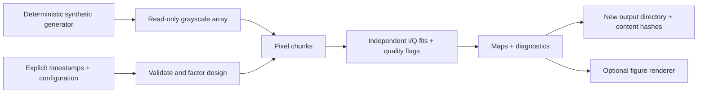

# Architecture and design decisions

The core is a NumPy-only array function. Input decoding, experiment metadata and
figure styling do not participate in the estimator. That separation makes the
numerical contract small enough to inspect and test independently.

## Decisions

**A single fixed reference.** The caller supplies frequency; the solver never
chooses a favorable frequency separately for each pixel. A displayed frequency
scan is explicitly diagnostic. Real calibration belongs upstream.

**Joint baseline and signal fit.** A Legendre basis spans the requested polynomial
drift while keeping the basis better scaled than raw time powers. SVD avoids
forming normal equations. Subtracting each trace's first value before projection
reduces unnecessary cancellation from large camera offsets.

**Factor once, process chunks.** The design decomposition costs roughly
`O(T p²)`, with `p = d + 3`. Processing all `P` pixels costs roughly `O(T p P)`.
Working storage scales as `O(T C + p T + P)` for chunk size `C`, excluding the
caller-owned input and constant-factor temporary buffers. The CLI uses a
read-only `.npy` memory map. This is chunked, offline processing, not a claim of
real-time hardware throughput or fully streaming acquisition.

**Explicit data contracts.** No automatic grayscale conversion, frame dropping,
bit-depth reduction or saturation inference. A bad trace does not contaminate
its neighbors. Pixel masks and counts remain available for audit.

**Small dependency surface.** NumPy is the only runtime dependency for analysis.
Matplotlib is optional for figures; tests and build tools are development extras.
There is no web service, cloud dependency, telemetry or dataset downloader.

**Output isolation.** Each CLI run owns a new directory and begins with an
incomplete receipt. Successful completion hashes every output. A failed run is
retained for inspection, marked incomplete, and never reused automatically.
Receipts do not store absolute input paths; local input content is identified by
SHA-256. A file hash records identity, not scientific validity.

**Independent public history.** The public companion begins with an explicitly
reviewed file set. It does not inherit research-repository history, deleted
datasets, exploratory notebooks or archived results.

## Maintenance boundaries

Add a new decoder as an adapter that returns explicit timestamps and one
grayscale array; keep hidden selection rules out of `core.py`. Adding irregular
sampling, correlated-noise inference or time-varying coefficients would change
the numerical contract and must bring new mathematical tests and documentation.
No extension is claimed to exist until it is implemented and exercised.
