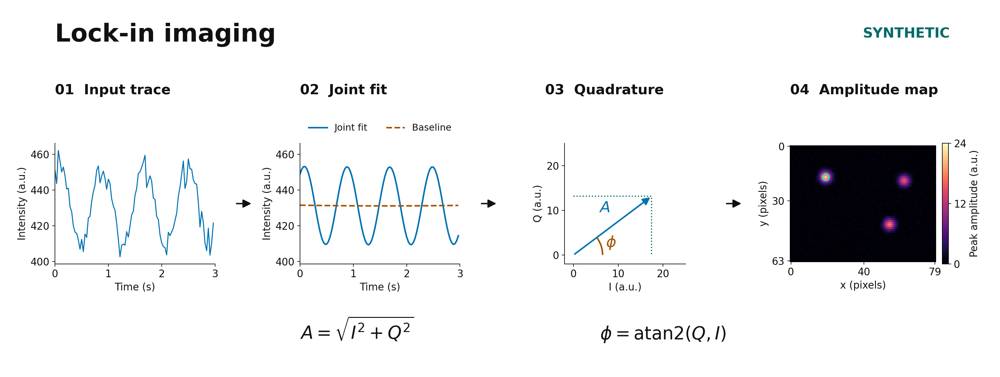
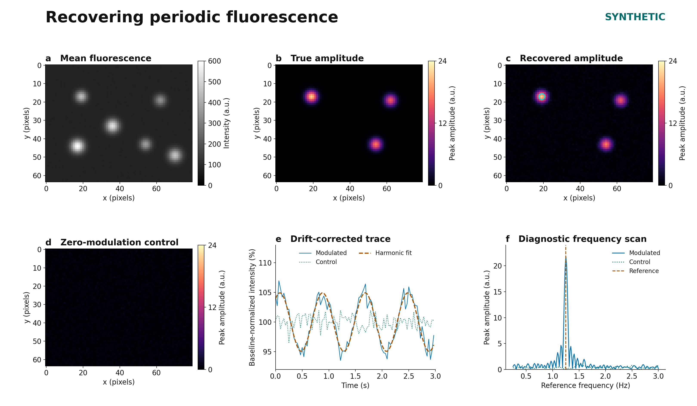

# Figure legends

These captions accompany both PNG and editable SVG versions. All displayed data
are generated by [synthetic.py](../src/lockin_imaging/synthetic.py); no panel uses
an experimental image. The gallery uses seed `20261023`. A custom-seed CLI demo
has its own metrics and is not the exact realization described here.

## Figure 1. From a recorded trace to a pixelwise amplitude map

**01, Input trace.** Fluorescence intensity at the predetermined synthetic pixel
`(y, x) = (17, 19)`; the first 96 frame centers, from 0 to 2.96875 s, are displayed
on a 0–3 s axis. **02, Joint fit.** The blue curve is the fitted polynomial plus
exposure-averaged harmonic; the dashed brown curve is the fitted polynomial
baseline. Both curves come from fitting all 512 frames, not from fitting this
excerpt. Panels 01 and 02 use identical intensity limits. **03, Quadrature.** The
arrow ends at the exposure-corrected coefficients `(I, Q)` for this same pixel;
its length is the sinusoidal peak amplitude `A` and its angle is
`φ = atan2(Q, I)`. The I and Q axes have equal physical scale. The phase convention
is `A cos[2πf(t−t₀)−φ]`, with `t₀` the first frame center. **04, Amplitude map.**
Applying the same design independently to every pixel gives the complete
64 × 80 map. The cyan ring marks the pixel used in panels 01–03. This map is the
same recovered amplitude shown in Figure 2c. Arrow, curves and map are outputs
of the same synthetic recording; the map is not a separately invented icon.

The workflow summarizes an offline, fixed-frequency regression. The underlying
package also exports phase, baseline, residual, covariance and quality maps;
they are not all displayed here. Figure 2 and the settings table below specify
the forward model. No measured sensitivity or experimental identification
performance is claimed.

## Figure 2. Synthetic truth, recovery and a zero-modulation control

**a, Mean fluorescence.** Arithmetic temporal mean of the generated signal stack,
including responsive fluorescence, static fluorescence, background and noise.
The linear grayscale spans 0–600 arbitrary intensity units (a.u.). Brightness
alone does not distinguish the three modulating sources from the three static
sources. **b, True amplitude.** Injected *pre-exposure sinusoidal peak amplitude*,
equal to 6% of the responsive fluorescence component, not 6% of the total
intensity. **c, Recovered amplitude.** `sqrt(I² + Q²)` from the joint quadratic
baseline and harmonic fit. The cyan ring marks the fixed example pixel.
**d, Zero-modulation control.** The control uses the same noiseless baseline and
drift as the signal stack, with no injected harmonic and a separate Gaussian
noise draw. The fitted magnitude is generally positive even under this null
model. Panels b–d all use the same linear 0–24 a.u. scale and the same `magma`
colormap; no per-panel amplitude normalization, detection threshold, spatial
smoothing or zeroing is applied. All pixels are shown without color clipping.
Coordinates are zero-based; x increases rightward and y downward.

**e, Drift-corrected trace.** The fixed pixel `(17, 19)` is chosen from the
generator geometry, not by searching for the best fit. Blue and dotted green
curves show the signal and control after removing each stack's own jointly
fitted polynomial `b̂ₖ` and restoring its fitted temporal mean `B̂`:

$$z_k = 100\,\frac{y_k-\widehat b_k+\widehat B}{\widehat B},
\qquad \widehat B=\frac{1}{N}\sum_k\widehat b_k.$$

The dashed brown curve is the signal's fitted harmonic on this same display
scale: `100[1 + h(I cos + Q sin)/B̂]`. Its excursion is the **exposure-attenuated**
harmonic relative to the fitted baseline, whereas panels b–d report the
**exposure-corrected** amplitude. All parameters are estimated on the full
record; only frame centers in `[0, 3)` s are drawn. The baseline includes the
invented background. The trace is not normalized to its own min/max or to a
selected peak, and it is not an ON/OFF contrast plot.

**f, Diagnostic frequency scan.** For each of 177 evenly spaced frequencies from
0.25 to 3 Hz (step 0.015625 Hz), a fresh joint quadratic-plus-harmonic fit is
applied to the full original signal and control traces at the same fixed pixel.
Exposure response is recalculated at each frequency. The brown vertical line
marks the supplied 1.25 Hz reference used to form the image maps. The scan does
not select a frequency for those maps. The plotted line joins evaluated
frequencies; its fine spacing is not an independent frequency resolution or a
measured linewidth. No FFT, taper, additional low-pass filter or frequency-peak
threshold is used. The finite record, polynomial projection and noise all shape
this response; see [Appendix H](appendix-mathematics.md#frequency-response).

### Shared synthetic settings

| Quantity | Value or definition |
|---|---|
| Random generator seed | `20261023` |
| Array shape | 512 frames × 64 rows × 80 columns |
| Frame-center interval | 1/32 s; centers 0 through 15.96875 s |
| Nominal sampled record length | `N Δt = 16 s`; first-to-last-center span is 15.96875 s |
| Rectangular exposure duration | 0.018 s, centered on each timestamp |
| Reference frequency and phase | 1.25 Hz and 0.65 rad in the stated minus-phase convention |
| Exposure transfer | `sinc(fτ) ≈ 0.9991674601`, with normalized sinc |
| Responsive spots `(y, x, height)` | `(17,19,360)`, `(43,54,290)`, `(19,62,260)`; Gaussian spatial SD 2.2 pixels |
| Static spots `(y, x, height)` | `(44,17,520)`, `(33,36,450)`, `(49,70,380)`; Gaussian spatial SD 2.5 pixels |
| Baseline | `80 + responsive + static`, in a.u. |
| Harmonic peak amplitude | `0.06 × responsive`, in a.u. |
| Multiplicative baseline drift | `1 + 0.035u + 0.02(u² − mean(u²))`, with 512 equally spaced `u ∈ [−1,1]` |
| Noise | Independent additive Gaussian draws, SD 4.5 a.u. per frame/pixel; independent signal/control draws |
| Stored input type | float32; solver and mean-image accumulation use float64 |
| Fit | One quadratic baseline and one I/Q pair per pixel for the entire record |
| Spatial preprocessing | None |

These values define a software example, not an acquisition recipe. The exposure
transfer is close to one in this illustration; stronger attenuation is exercised
by a separate numerical-integration test. The simple homoskedastic noise model
does not simulate photon-counting statistics, motion or correlated camera noise.
The six spots and 5,120 pixels are not biological replicates.

### Numerical checks for this realization

Across all 5,120 pixels, including low-signal/background pixels, amplitude RMSE is
0.388359 a.u. The control median and 95th percentile are 0.322094 and 0.683917
a.u. The example pixel has injected amplitude 21.600000 a.u. and recovered
amplitude 21.822379 a.u. These summarize one seeded simulation; the control's
95th percentile is descriptive and is not used as a detection cutoff. Full
precision values are in [synthetic_metrics.json](assets/synthetic_metrics.json).

Both figures are rendered from code. The SVGs retain editable text. The captions
contain settings and interpretation so that the graphics can keep large,
high-contrast labels without a footnote layer.
